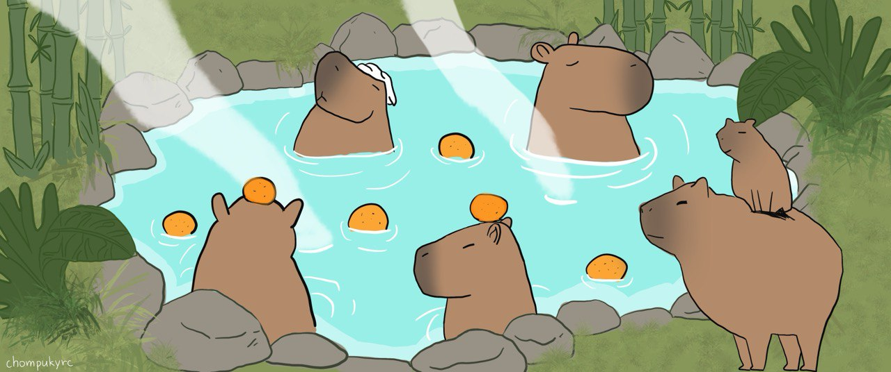

# Soak first, take notes later.

I'm Thana. I write down what I try in homelab, dev and AI, in Thai.
The blog and a few small tools are at [iamthana.com](https://iamthana.com).

Say hi at contact@iamthana.com or on [LinkedIn](https://www.linkedin.com/in/thana-tingprasom/).

## Latest posts

<!-- BLOG-POST-LIST:START -->
- [โหลด Agent Skills ฟรีมาใช้ ต้องระวังอะไร และตรวจสอบอย่างไร?](https://iamthana.com/blogs/2026-11-02-agent-skills-security-check)
- [ใช้ Claude Code ช่วยดูแล Server ได้ไหม และควรระวังอะไรบ้าง](https://iamthana.com/blogs/2026-10-27-claude-code-server-management)
- [เปลี่ยนข้อความสไตล์ AI ให้เป็นธรรมชาติมากขึ้นด้วย Humanizer Skill](https://iamthana.com/blogs/2026-10-17-humanizer-skills)
- [ลองใช้ Headroom บีบ context ก่อนส่งเข้า Claude Code](https://iamthana.com/blogs/2026-09-16-headroom)
- [ตั้งค่า node_exporter ให้ปลอดภัยด้วย mTLS และ Basic auth](https://iamthana.com/blogs/2026-08-07-node-exporter-mtls-basic-auth)
<!-- BLOG-POST-LIST:END -->
